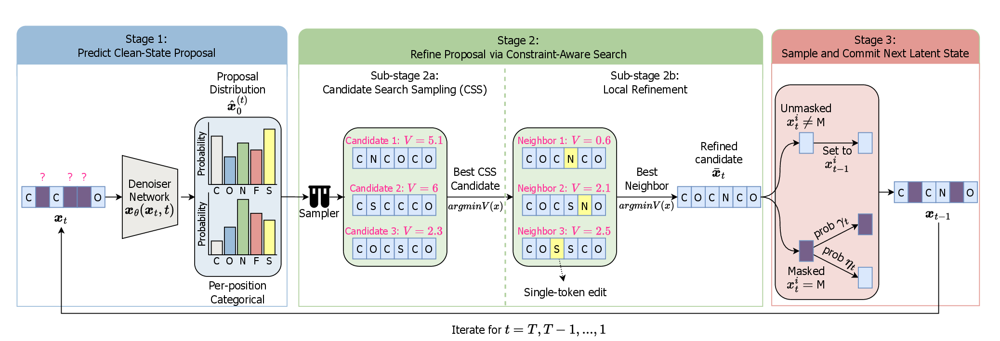

# SearchDiff: Search-Augmented Masked Diffusion Models for Constrained Generation

This repository is the official implementation of **“Search-Augmented Masked Diffusion Models for Constrained Generation,”** accepted at NeurIPS 2026.

**Authors:** Huu Binh Ta, Michael Cardei, Alvaro Velasquez, and Ferdinando Fioretto.

## Method Overview

SearchDiff is a training-free inference framework for constrained generation with masked diffusion models. It supports black-box, non-differentiable constraint and property evaluators without retraining or modifying the underlying generative model.

At every reverse denoising step, SearchDiff:

1. Uses **Candidate Search Sampling (CSS)** to draw clean-sequence candidates from the denoiser proposal and select the candidate with the lowest constraint violation.
2. Applies **constraint-aware local refinement** through admissible single-token edits.
3. Uses the refined candidate in a **modified reverse transition** to produce the next latent state.

[](illustration/methodology.pdf)

## Installation

### Requirements

- Linux
- [Conda](https://docs.conda.io/)
- An NVIDIA GPU with an **Ampere or newer** architecture
- CUDA 12.1

SearchDiff builds upon the [UDLM source code](https://github.com/kuleshov-group/discrete-diffusion-guidance). The base model and its CUDA kernels require an Ampere-or-newer NVIDIA GPU.

Install SearchDiff and activate its Conda environment with:

```bash
git clone https://github.com/Tahuubinh/mdlm_search.git
cd mdlm_search
bash install_searchdiff.sh
conda activate searchdiff
```

The installation script creates the `searchdiff` environment from `environment.yml` and builds the CUDA extensions for `causal-conv1d` and `mamba-ssm`.

## Data

### QM9

The QM9 data used by this code is available from the [`yairschiff/qm9`](https://huggingface.co/datasets/yairschiff/qm9) dataset on Hugging Face. Run the preparation script:

```bash
python dataset/download_qm9.py
```

The training-set reference is saved to `data/QM9/qm9_canonical_smiles.txt` and is used to determine whether generated molecules are novel. Users should follow the terms of the original dataset when downloading and using it.

### Peptides (GRAMPA)

Run the following command to download and prepare the GRAMPA peptide data:

```bash
python dataset/download_peptides.py
```

The processed sequences are saved to `data/peptides/filtered_peptides_46.txt`.

### Mammalian tRNA

The tRNA training data were assembled from the mature tRNA sequences of 72 mammalian genomes in [GtRNAdb](https://gtrnadb.org/browse.html#Mammalia_atod). The exact archive filenames are listed in [`dataset/trna_mammalian_genomes.txt`](dataset/trna_mammalian_genomes.txt). Download these tRNAscan-SE result archives manually from the **Mammalia** section, extract them, and collect each `*-mature-tRNAs.fa` file in `data/trna/mature/`. Then run:

```bash
python dataset/prepare_trna.py
```

The script combines the FASTA records, converts `T` to `U`, and saves one sequence per line to `data/trna/final_sequences.txt`.

## Checkpoints

Download the pretrained model checkpoints from the [SearchDiff checkpoint folder](https://myuva-my.sharepoint.com/:f:/g/personal/nzj6jt_virginia_edu/IgAII7W3_SY8Ro203F2E_iDKAYJ3RenCGd1JZuFBZoMHrF4?e=6tEnL3) and place them in the repository with the following directory structure:

```text
outputs/
├── QM9/
│   └── mdlm/
│       └── best.ckpt
├── grampa/
│   └── mdlm_no-guidance_padTrue/
│       └── checkpoints/
│           └── best.ckpt
└── trna/
    └── mdlm_no-guidance_full/
        └── checkpoints/
            └── best.ckpt
```

## How to Run

SearchDiff uses `inference_search.py` for constrained generation across all supported domains. The general command is:

```bash
python inference_search.py \
  --data DATA \
  --num_samples NUM_SAMPLES \
  --batch_size BATCH_SIZE \
  --property_type PROPERTY_1 PROPERTY_2 ... \
  --lower_bound LOWER_1 LOWER_2 ... \
  --upper_bound UPPER_1 UPPER_2 ... \
  --x_theta_type bon_localsearch \
  --num_x_theta_samples NUM_CANDIDATES \
  --x_theta_num_local_searches NUM_LOCAL_SEARCHES \
  --version RUN_NAME \
  --seed SEED
```

The properties and their lower and upper bounds are matched by position. For example, `LOWER_1` and `UPPER_1` define the admissible range for `PROPERTY_1`. `RUN_NAME` is used only to label the output directory. Reduce `BATCH_SIZE` if GPU memory is limited. See all available options with `python inference_search.py --help`.

### QM9

The following command generates molecules satisfying synthetic accessibility (SA) and QED constraints:

```bash
python inference_search.py \
  --data qm9 \
  --num_samples 1024 \
  --batch_size 512 \
  --property_type sa qed \
  --lower_bound -1000 1 \
  --upper_bound 4 1000 \
  --x_theta_type bon_localsearch \
  --num_x_theta_samples 32 \
  --x_theta_num_local_searches 1 \
  --version test \
  --seed 0
```

### Peptides (GRAMPA)

The following command constrains peptide length, hydrophobic ratio, and net charge:

```bash
python inference_search.py \
  --data grampa \
  --num_samples 1024 \
  --batch_size 512 \
  --property_type peptide_length hydrophobic_ratio net_charge \
  --lower_bound 10 0.3 2 \
  --upper_bound 50 1000 9 \
  --x_theta_type bon_localsearch \
  --num_x_theta_samples 128 \
  --x_theta_num_local_searches 2 \
  --version test \
  --seed 0
```

### tRNA

The following command constrains the acceptor-stem length, T-loop length, and predicted fold:

```bash
python inference_search.py \
  --data trna \
  --num_samples 1024 \
  --batch_size 512 \
  --property_type acceptor_stem t_loop fold \
  --lower_bound 7 6 3 \
  --upper_bound 9 1000 1000 \
  --x_theta_type bon_localsearch \
  --num_x_theta_samples 1 \
  --x_theta_num_local_searches 1 \
  --version test \
  --seed 0
```

## Repository Structure

```text
inference_search.py           Main entry point for constrained generation
inference_utils.py            Inference configuration and checkpoint loading
diffusion_search.py           Masked-diffusion sampling with SearchDiff
x_theta_modifier/             CSS and constraint-aware local refinement
posterior_sampling_modifier/  Reverse-transition sampling utilities
properties/                   Domain-specific constraint evaluators
custom_datasets/              Dataset loaders and tokenizers
dataset/                      Data download and preparation scripts
evaluation/                   Property evaluation and result analysis
```

## Acknowledgments

SearchDiff is built upon the UDLM codebase released in [Discrete Diffusion Guidance](https://github.com/kuleshov-group/discrete-diffusion-guidance). We thank the original authors for making their implementation publicly available.

## License

The code in this repository is released under the [Apache License 2.0](LICENSE). Third-party datasets remain subject to the licenses and terms of their original sources. The pretrained checkpoints are distributed separately and may also be subject to the terms associated with the upstream code and training datasets. Users are responsible for verifying that their use complies with all applicable terms.

